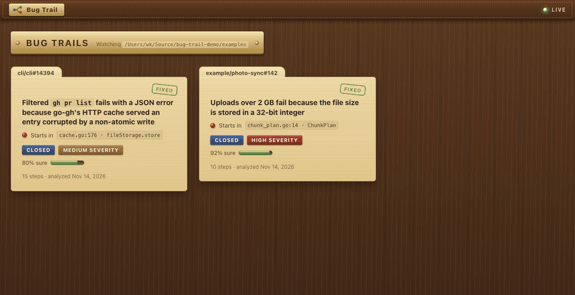

# Bug Trail

See which part of the code causes a bug, and what it should do instead.

A coding agent traces a GitHub issue through the code and writes a **bug trail**: the components
the bug passes through, the steps in the order they run, where the bug starts and where the user
sees it, next to the correct logic, with concrete cases and the background a reader needs. Bug
Trail draws it as an evidence board you can step through.

Bug Trail is a single Go binary with two jobs:

1. **It ships a skill** that any coding agent can follow (Claude Code, Codex, OpenCode, Pi, …).
   Bug Trail never calls an AI model itself; the agent writes the trail file.
2. **It runs the dashboard** that draws each trail, locally or as a shared server.



<sub>Recorded from `bug-trail serve --dir examples`. Also available as an [MP4](docs/media/bug-trail-demo.mp4).</sub>

## Requirements

Homebrew (macOS or Linux), or Go 1.24 or later to build from source; no other dependencies.
Agents also need the GitHub CLI (`gh`), logged in.

## Quick start

```bash
brew install wk-j/tap/bug-trail                 # or: go install github.com/wk-j/bug-trail@latest
bug-trail skill setup                           # install the skill into the agents on this machine
bug-trail serve --open                          # dashboard on http://localhost:4317
```

Then ask your agent:

> Use the bug-trail skill to analyze https://github.com/OWNER/REPO/issues/123

The map appears as soon as the agent saves the trail, and redraws when it changes. To look around
without running an agent, clone the repository and run `bug-trail serve --dir examples`.

To share trails with a team, [deploy a server](docs/deploy.md) and point each machine at it with
`bug-trail config set server URL`.

## Docs

- [Using the map](docs/using-the-map.md)
- [Agents and the skill](docs/agents.md)
- [Command reference](docs/cli.md)
- [Configuration](docs/configuration.md)
- [Deploy a shared server](docs/deploy.md)
- [Development](docs/development.md)
- [Releasing](docs/releasing.md)
- [Trail format](skill/bug-trail/FORMAT.md)
